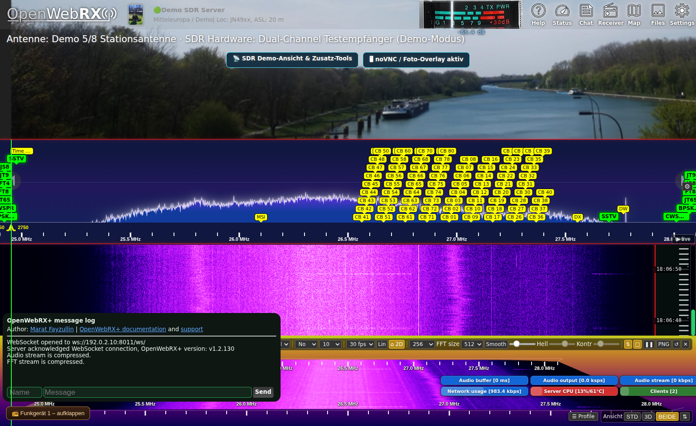
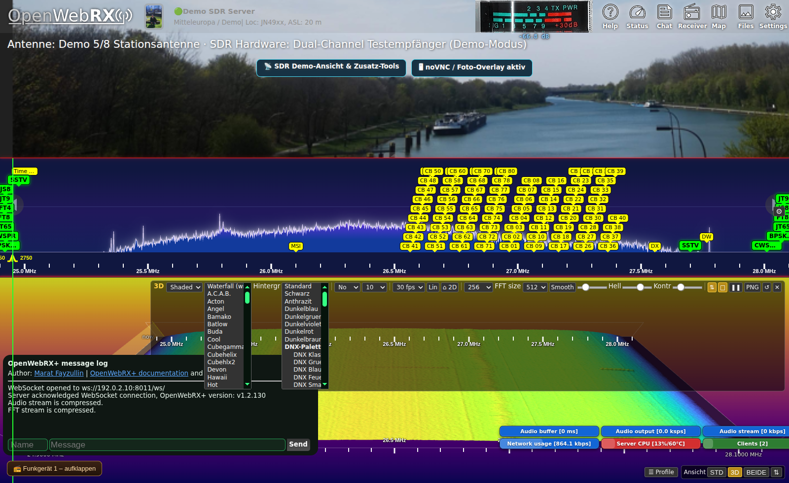

# DNX Integrated Waterfall 3D (`v3.10`)

<!-- DNX-DISCLAIMER-START -->
> **Wichtiger Hinweis / Vollständige Distanzierung (Hobby-Mod-Mode)**
>
> - **Vollständige Distanzierung:** Ich distanziere mich in jeder Hinsicht vollständig vom Projekt **OpenWebRX / OpenWebRX+** sowie dessen Entwicklern und Betreibern. Es besteht keinerlei Verbindung, Zusammenarbeit, Prüfung, Befürwortung oder Partnerschaft.
> - **Keine öffentlichen/offiziellen OpenWebRX-Plugins (nur Mod-Mode):** Bei diesem Projekt handelt es sich ausdrücklich **nicht** um ein öffentliches oder offizielles Plugin von OpenWebRX, sondern ausschließlich um einen privaten, inoffiziellen **Mod-Mode** (Eigenmodifikation).
> - **Warum bewusst kein reines Browser-JavaScript (Mod-Mode-Architektur):** Viele Funktionen (z. B. serverseitige Speicherung, Konten-/Rollenverwaltung, Profil-Synchronisation, VNC-/websockify-Brücken, geschützte Schnittstellen, Docker-/Systemintegration und stabile UI-Anpassungen) lassen sich sauber und sicher nicht allein über simples Client-JavaScript umsetzen, ohne den OpenWebRX-Kern umzubauen oder Browsergrenzen zu umgehen. Deshalb setzt dieses Projekt bewusst auf getrennte Begleitmodule, Shell-Installer und Dienste im **Mod-Mode** statt alles künstlich in reines JavaScript zu pressen.
> - **Kein öffentlicher Support & keine Haftung:** Es gibt **keinen öffentlichen Support**, keine Garantie und keine Haftung. Nutzung, Installation und Anpassung erfolgen vollständig auf eigene Gefahr (immer vorher Backups anlegen und zunächst im eigenen Testsystem prüfen).
> - **Reines Hobbyprojekt – frei nutzbar, änderbar & verbreitbar:** Dieses Projekt entsteht ausschließlich aus reinem Hobby und Interesse am gemeinsamen Funk-/SDR-Hobby. Es steht ausdrücklich frei zur Verfügung und darf frei genutzt, weiterverbreitet, verändert und verbessert werden.
<!-- DNX-DISCLAIMER-END -->

> **Important Notice / Full Disassociation (Hobby Mod-Mode Only)**
>
> - **Full Disassociation:** I completely disassociate myself from **OpenWebRX / OpenWebRX+** and its developers/maintainers. There is no affiliation, endorsement, review, or partnership of any kind.
> - **No Official/Public OpenWebRX Plugins (Mod-Mode Only):** These files are **not** official or public OpenWebRX plugins, but purely unofficial hobby modifications (*mod-mode*).
> - **Why Not Everything in Pure Browser JavaScript:** Many features (server-side persistence, account/role management, profile syncing, VNC/websockify bridges, protected endpoints, and Docker/host integration) cannot be implemented cleanly or reliably in client-side JavaScript alone without modifying the OpenWebRX core or hitting browser/security limits. That is why this project intentionally uses separate companion scripts, services, and *mod-mode* hooks rather than forcing everything into pure JS.
> - **No Public Support & No Warranty:** There is **no public support**, no warranty, and no liability. Use entirely at your own risk (always create backups and verify on a test system first).
> - **Pure Hobby Project — Free to Use, Modify & Redistribute:** Created solely out of personal hobby interest in the radio/SDR hobby; freely available to use, share, modify, and improve.

<!-- DNX-PREVIEW-START -->
## Live-Vorschau & Galerie / Live Preview (`DNX Integrated Waterfall 3D`)



| Ansicht / View | Beschreibung / Description | Screenshot |
|---|---|---|
| **BEIDE-Modus (Split STD + 3D)** | Geteilte Live-Ansicht aus klassischem 2D-Wasserfall oben und integriertem WebGL-3D-Wasserfall unten samt `Ansicht: STD | 3D | BEIDE | ⇅` |  |
| **Vollbild 3D-Ansicht** | Reiner `3D`-Wasserfall-Modus mit freier Perspektive, Frequenzskala und Klick-Abstimmung direkt in der 3D-Fläche |  |
| **3D-Toolbar & Auswahlmenüs** | Alle Dropdowns (`Outline/Ribbon`, `Waterfall`, `Hintergrund`, `Palette`, `FPS`, `FFT size`, `Hell/Kontrast`) inkl. `Smooth`, Pause und PNG-Export |  |
<!-- DNX-PREVIEW-END -->

Integrierte WebGL-3D-Wasserfallansicht (`dnx_3dtool.js v3.10`) direkt in der OpenWebRX-Oberfläche (`STD`, `3D`, `BEIDE`, `⇅`).

Integrated real-time WebGL 3D waterfall view (`dnx_3dtool.js v3.10`) embedded inside OpenWebRX with `STD`, `3D`, `BEIDE` (split), and `⇅` (swap order) controls.

> Hinweis: Dies ist die integrierte Wasserfall-Leiste (`STD / 3D / BEIDE / ⇅`) – nicht das eigenständige große Popup-Fenster `DNX 3D Tool`.

## Funktionen & Upgrade v3.10 / Features & What's New

- **4 Ansichtsmodi:** `STD` (Standard-2D), `3D` (reines 3D-Spektrogramm), `BEIDE` (Synchron-Split 2D + 3D) und `⇅` (Anordnung tauschen).
- **Live-WebGL-Einstellungen:** Modus (`Outline`, `Ribbon`, `Surface`), Farbkarte (`sdrangel_plasma`, `Classic`, `Turbo`, `Inferno`, …), 3D-Hintergrund, Mittelung (`AVG`), FPS-Limit, `Lin/Log`, `2D/3D`-Kippwinkel, Tiefe (`History`), `FFT size`, `Smooth`, Helligkeit, Kontrast, Pause, Reset & PNG-Schnappschuss.
- **Direkte Abstimmung:** Klick in die 3D-Fläche stimmt den Empfänger direkt auf die gewünschte Frequenz ab.
- **Universal-Installer (`install.sh`):** Unterstützt automatisch Docker (`CONTAINER=...`) sowie native Installationen (`TYP=normal PLUGINS=/pfad/zu/plugins`) inklusive Backup in `/opt/dnx-integrated-waterfall-backups`, `status`, `update` und `uninstall`.

## Dateien im Paket / Package Contents

| Datei | Ziel / Target | Zweck / Purpose |
|---|---|---|
| `install.sh` | Host (root) | Universal-Installer (`install`, `update`, `status`, `uninstall`) |
| `files/dnx_3dtool.js` | `…/receiver/dnx_3dtool/dnx_3dtool.js` | Integriertes 3D-Wasserfall-Modul (`v3.10`) |
| `files/dnx_3dtool.css` | `…/receiver/dnx_3dtool/dnx_3dtool.css` | Layout- & Toolbar-Styles |
| `loader-example.js` | Referenz | Beispiel-Snippet für manuelles Laden in `init.js` |
| `docs/` | — | 3 Funktionsscreenshots (`1600×980`) |

## Installation / Upgrade

```bash
chmod +x install.sh
sudo ./install.sh install
# Ohne Docker / Native installation:
sudo TYP=normal PLUGINS=/usr/lib/python3/dist-packages/htdocs/plugins ./install.sh install
# Status / Update / Entfernen:
./install.sh status
sudo ./install.sh update
sudo ./install.sh uninstall
```

